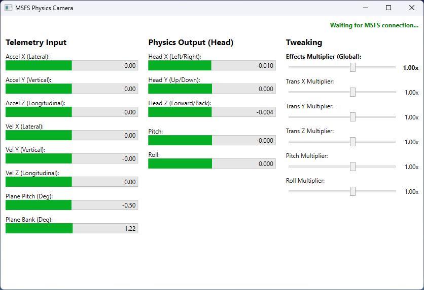
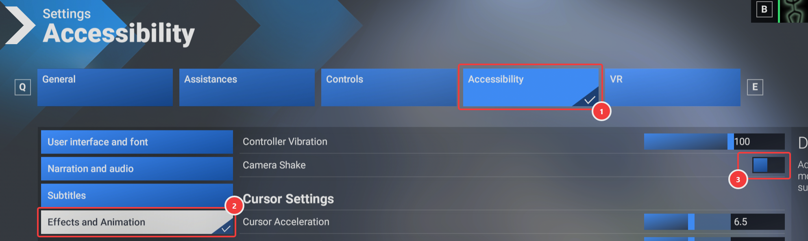

# MSFS Physics Camera


A standalone application for Microsoft Flight Simulator 2020/2024 that adds realistic, physics-based head movements (head shake, G-force effects) to the virtual cockpit. It reads aircraft telemetry via SimConnect and injects camera movements using the FreeTrack protocol.

## Features

- **Physics-Based Movement**: Uses a spring-mass-damper physics engine to simulate realistic head movements based on aircraft acceleration and velocity.
- **Customizable Effects**: Adjust the intensity of lateral, vertical, longitudinal, pitch, and roll movements in real-time via the UI, and many other settings.
- **Profiles & Sharing**: Save, load, overwrite, and delete custom tweaking presets, and share or import profiles using `MSFSCAM...` share codes.
- **Per-Aircraft Settings**: Optionally remember your active profile and custom tweaking settings automatically for each aircraft.
- **Seamless Integration**: Connects to MSFS via SimConnect and injects data via FreeTrack.
- **Auto-Start & Auto-Exit**: Includes scripts to automatically start with MSFS, and a setting to automatically exit when MSFS closes.

## Showcase



https://github.com/user-attachments/assets/754c5b30-4dcb-49b1-9095-6a5220380bea

https://github.com/user-attachments/assets/f35fa594-357c-4c8a-a619-67fbac6674d8

https://github.com/user-attachments/assets/abc0d6e2-2e89-48db-8f8d-b41ec855b2ba

## Compatibility

Verified to work on:
- Microsoft Flight Simulator 2020
- Microsoft Flight Simulator 2024

## Installation

1. Download the latest release.
2. Extract the files to your MSFS Community folder (or any other folder of your choice).
3. Run `AutoStart-Install.bat` to register the application to start automatically when MSFS launches.
   - *To uninstall the auto-start behavior, run `AutoStart-Uninstall.bat`.*
4. Alternatively, you can run `MsfsPhysicsCamera.exe` manually before or during your flight.
5. You'll likely want to disable the built-in camera shake 

*Note: TrackIR/FreeTrack is automatically enabled on first run if found to be unconfigured using the included `NPClient64.dll`.*

## FAQ

**I do see telemetry and output in the app while moving my airplane ingame, but my camera does not seem to react. Even at x5 multiplier. What gives?**

Restart MSFS. Launching the app for the first time enables the "TrackIR" controller, which requires an MSFS restart to show up.

**Can I use this app together with my head tracker (Tobii / TrackIR / Opentrack / Beam Eye Tracker)?**

No. Both your head tracker and this app send absolute camera values to MSFS, so it will either pick one or alternate between them and cause jitter.

(The green "Head tracking is configured correctly" status just means this app's own virtual TrackIR hook is set up, not that external head trackers are supported.)

**Can I use this app in VR?**

No, in VR you are already wearing a head tracker. A virtual head tracker would mess it up.

**Does this work with ChasePlane or FSRealistic?**

Anything else that fakes head tracking (like ChasePlane's "Human Touch") will conflict. Disabling that feature on the other app's side may let them work together. FSRealistic isn't tested, though some users report running both fine.

**It feels like the camera is drifting at high speed or in turns**

While ascending/descending the gravity weighs on your head while you're pitched up/down. Similarly in turns. Since v1.5 there are two settings that remedy this, of which one is enabled by default.
* The "Return-to-center speed" (defaulting to 0.5) option will make the camera return to center slowly over time.
* Disabling "Simulate gravity" prevents the fake gravity calculation based on pitch/roll angles.

**The effect is too strong or too weak for my plane**

Defaults are tuned for bizjets, so GA or airliners will likely need tweaking. Changes apply live without restarting and save automatically. Note that dragging a multiplier slider all the way left goes to `-5x` (inverted) — `0x` is off. Use **Clamps** to cap max camera travel.

**Why does the camera spike or jump in certain aircraft (e.g. A2A Comanche, Fenix)?**

The app uses raw SimConnect telemetry. Some aircraft inject exaggerated accelerations (like custom taxi vibrations), which the physics engine picks up. Lower or zero out the affected axis multiplier (usually `Trans Y` or `Trans X`), or tighten **Clamps**.

**Where is the settings panel? Is there an in-game toolbar?**

There is no in-game panel; it's a standalone Windows app. If you enabled minimize to tray, check your system tray.

**AutoStart-Install.bat can't find `exe.xml`**

Make sure you're on v1.7+ (it creates `exe.xml` if missing). Auto-start is optional anyway—you can just run `MsfsPhysicsCamera.exe` manually before or during a flight.

**How do I completely uninstall, or why did another game's camera break?**

`AutoStart-Uninstall.bat` only removes the auto-start entry. To remove the TrackIR hook as well, delete `HKEY_CURRENT_USER\Software\NaturalPoint\NATURALPOINT\NPClient Location`.

## Development

### Prerequisites

- [.NET 10.0 SDK](https://dotnet.microsoft.com/download/dotnet/10.0)
- Microsoft Flight Simulator 2024 SDK (required for `SimConnect.dll`)

### Setup

```bash
# Clone the repository
git clone https://github.com/martijns/martijns-msfs2024-physics-camera.git
cd martijns-msfs2024-physics-camera

# Build the project
dotnet build
```

*Note: The project expects `SimConnect.dll` to be located at `c:\MSFS 2024 SDK\SimConnect SDK\lib\SimConnect.dll`.*

### Debugging

You can run and debug the application directly from Visual Studio or VS Code. The application will attempt to connect to SimConnect and the FreeTrack shared memory automatically.

## License

MIT License - see LICENSE file for details.
